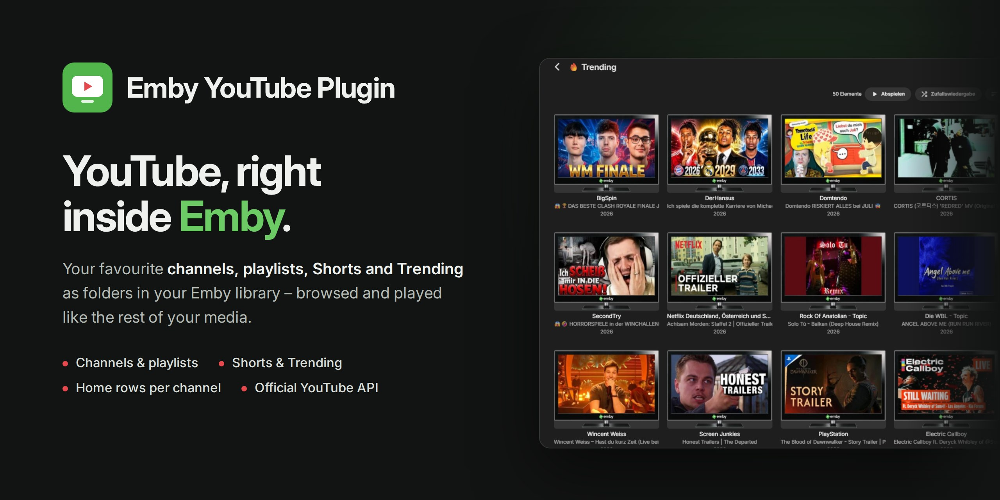

  

  
  
  

# Emby YouTube Plugin

**YouTube, right inside Emby.** Add the YouTube channels and playlists you like
once, and they appear in Emby as folders next to your movies and shows. Trending,
categories and Shorts are there too, and videos play in Emby's own player without
YouTube ads.

The plugin uses the official YouTube Data API v3. You need a free API key from
Google – the built-in setup guide walks you through it.

## Highlights

- Add YouTube channels by `@handle` or channel ID.
- Add playlists as their own Emby folders.
- Add search folders for occasional YouTube searches.
- Create Watch Later-style folders from playlist IDs.
- Show Trending and category folders for a selected region.
- Split channels into Videos and Shorts when those folders have content.
- Hide Shorts globally if you prefer a long-form-only view.
- Hide empty playlists, categories, and Shorts folders.
- Optionally show the YouTube folders at the top level and, on Emby 4.10+, add a "latest videos" row on the home screen for each saved channel (replaces Emby's combined YouTube row; can be switched back).
- Track estimated daily YouTube API quota usage.
- **My YouTube:** each Emby user can have their own API key and channel list (optional, enabled by the admin).
- Ad-free playback in Emby's own player (2.0.12+), up to 1080p. If you switch to the optional YouTube embed player, YouTube may show ads.

## Screenshots

### Setup Guide

 

 

 

 

### Emby Root Folder

### Channel Folders

### Video Listing

## Requirements

- An Emby Server.
- A YouTube Data API v3 key from Google Cloud. The built-in Setup Guide walks you through creating one.
- .NET 8 SDK, only if you want to build the plugin from source.

The API key only needs access to public YouTube data. After installation, open the plugin settings and use the built-in **Setup Guide** to create and restrict the key.

## Installation

1. Download [`Emby.YouTubePlugin.dll`](https://github.com/eliasbruno124-dev/Emby-Youtube-Plugin/releases/latest/download/Emby.YouTubePlugin.dll)
   from the [latest release](https://github.com/eliasbruno124-dev/Emby-Youtube-Plugin/releases/latest).
2. Copy the DLL into Emby's `programdata/plugins` folder.
3. Restart Emby.
4. Open the YouTube plugin settings.
5. Use the **Setup Guide** tab to create a YouTube Data API v3 key.
6. Paste the API key into the **Settings** tab.
7. Add at least one channel, playlist, or search entry.
8. Save the settings.

Useful Google Cloud pages:

- YouTube Data API v3: https://console.cloud.google.com/apis/library/youtube.googleapis.com
- Credentials: https://console.cloud.google.com/apis/credentials

## Saved Content

The **Saved Content** field accepts:

- `@handle`, for example `@MrBeast`
- Channel IDs starting with `UC...`
- Playlist IDs starting with `PL...`
- Plain search text

Handles, channel IDs, and playlist IDs are the best options because they avoid the separate daily `search.list` limit. Plain search text works too, but each result page uses one Search Queries call.

The **Watch Later Playlists** field accepts playlist IDs. Each playlist becomes its own top-level folder and can be checked regularly for new videos.

## My YouTube

Administrators can enable **Allow personal API keys** and **Allow personal channels**
independently in the plugin settings. Both are off by default. In Emby Web,
open your avatar menu, choose **App settings**, then **My YouTube** under your
personal settings to save your own key or follow channels by `@handle` or `UC...`
channel ID. Version 2.0.12.1 fixes the missing settings entry in 2.0.12.0.
The resulting folders can also be browsed in native Emby clients; personal settings are managed through Emby Web.

The administrator chooses **Only the owner** to show each user's channels directly
in their YouTube root beside the common channels, without a **My YouTube**
subfolder. Other users cannot browse these personal entries. **All users** also
adds them to the common YouTube catalog.
With **All users**, there is no extra **My YouTube** folder, because the channels
are already in the common list – unless a user has their own API key. The
**My YouTube** settings page is always available. Verified administrator handle
mappings survive restarts and load before browsing is available. Missing mappings are resolved during startup, with a 30-second
API/cache budget; entries without a verified identity remain hidden.
Personal channels use the user's enabled key when present, otherwise the server
key; common channels use the server key. A failing personal key does not silently
fall back to the server key.

These are plugin-managed subscriptions, with no Google account sign-in or
automatic import of your YouTube account's subscriptions. See
[personal settings](docs/PERSONAL_YOUTUBE.md) for details and client limitations.

## Quota

Most browsing uses low-cost YouTube API endpoints:

| Action | Endpoint | Typical cost |
| --- | --- | --- |
| Channel uploads | `playlistItems.list` | 1 unit |
| Playlist videos | `playlistItems.list` | 1 unit |
| Video details | `videos.list` | 1 unit per batch |
| Categories | `videoCategories.list` | 1 unit |
| Search folders | `search.list` | 1 Search Queries call |

The plugin caches responses on disk. Search results are cached longer because
`search.list` has a separate default limit of 100 calls per day, while most
other endpoints share the regular 10,000-unit daily bucket. Cached channel upload
lists expire after 55 minutes and refresh on the next request. The quota panel
estimates requests using the shared server key; personal-key requests are kept
separate.

## Notes

- Videos play in Emby's own player by default, up to 1080p (when Emby transcodes, the output is capped at 30 fps). To use the YouTube embed player in the browser instead, turn off **Use the Emby player** and reload the app. If Emby playback fails, the plugin does not switch to the embed player by itself.
- Video information comes from the official YouTube Data API v3.
- Audio tracks, subtitles and chapters are available when the video has them; how you pick them depends on the Emby app.
- Resume and player cleanup depend on the Emby client. Bundled players may not use the server-side fixes.
- There is no Google sign-in and no access to private YouTube data. Personal API keys and channel lists are set under **My YouTube**.
- Tested with Emby Server 4.10.2 on Linux/Docker.
- After updating, restart Emby. If the web app still looks outdated, clear its browser cache.

## License

This project is licensed under the MIT License. See [LICENSE](LICENSE) for details.

## Support the Developer

This plugin is free and open-source, maintained with a lot of love in my spare time. If it brings value to your Emby setup, a small donation would mean the world to me.

  

